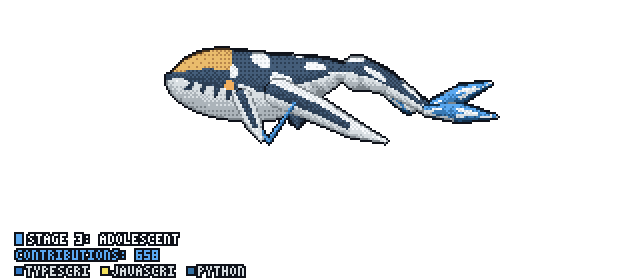

<!-- GitHub Profile README -->
<p align="center">
  
</p>


<!--
<p align="center">
  
</p>
-->
<p align="center">
    <!-- <a href="https://ayush-portfolio-jq2t.onrender.com" target="_blank">
      
    </a> -->
    <a href="https://drive.google.com/file/d/1mHmMe2o_kAyr-mfGVgqTag-uEhVJoveK/view?usp=sharing" target="_blank">
      
    </a>
    <a href="https://www.linkedin.com/in/m-zuhaib-kh/" target="_blank">
      
    </a>
    <a href="mailto:khanzuhaib966@gmail.com" target="_blank">
      
    </a>
    <!-- <a href="https://x.com/MDarkclues" target="_blank">
      
    </a> -->
    <!-- <a href="https://stackoverflow.com/users/ayush-gautam" target="_blank">
      
    </a> -->
    <a href="https://www.instagram.com/_._zuhaib_._/" target="_blank">
      
    </a>
  </p>


###  About Me

```yaml
name: Mohd Zuhaib Khan
title: Full-Stack Developer & Data Science Undergrad
education: B.Tech in Data Science (India)
core_interests: [Full-Stack Web Dev, AI/ML, Autonomous Agents, FinTech]
resume: https://drive.google.com/file/d/1mHmMe2o_kAyr-mfGVgqTag-uEhVJoveK/view?usp=sharing
current_focus: Building intelligent, scalable web applications & LLM agent workflows
status: Open for software engineering, full-stack & AI/ML opportunities
```

###  Tech Stack & Skills

<details open>
<summary><b>Programming Languages</b></summary>
<br/>


</details>

<details open>
<summary><b>Frontend & UI Engineering</b></summary>
<br/>


</details>

<details open>
<summary><b>Backend & Frameworks</b></summary>
<br/>


</details>

<details open>
<summary><b>Data Science, Machine Learning & AI</b></summary>
<br/>


</details>

<details open>
<summary><b>Databases & Cloud Deployments</b></summary>
<br/>


</details>

<details open>
<summary><b>Tools, Platforms & DevOps</b></summary>
<br/>


</details>

<table align="center">
<tr>
<td width="50%" align="center" valign="middle">
<a href="https://github.com/Mzuhaibkhan">

</a>
</td>
<td width="50%" align="center" valign="middle">
<a href="https://github.com/PramudithaN/git-tulkun">

</a>
</td>
</tr>
</table>


<p align="center">
  
  
</p>


<p align="center">
  <a href="https://www.linkedin.com/in/m-zuhaib-kh/">
    
  </a>
  <a href="https://www.chess.com/member/zuhaib-kh">
    
  </a>
  <a href="https://www.instagram.com/_._zuhaib_._/">
    
  </a>
 <a href="https://codeforces.com/profile/zuhaib_kh">
    
  </a> 

  <a href="https://leetcode.com/u/m_zuhaib-kh/">
    
  </a>
</p>

<p align="center">
  <a href="https://u8views.com/github/Mzuhaibkhan">
    
  </a>
  
</p>
